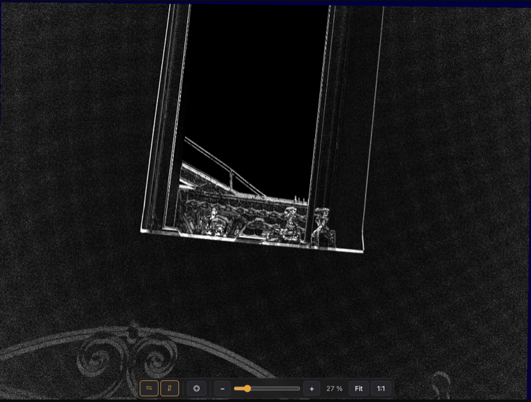
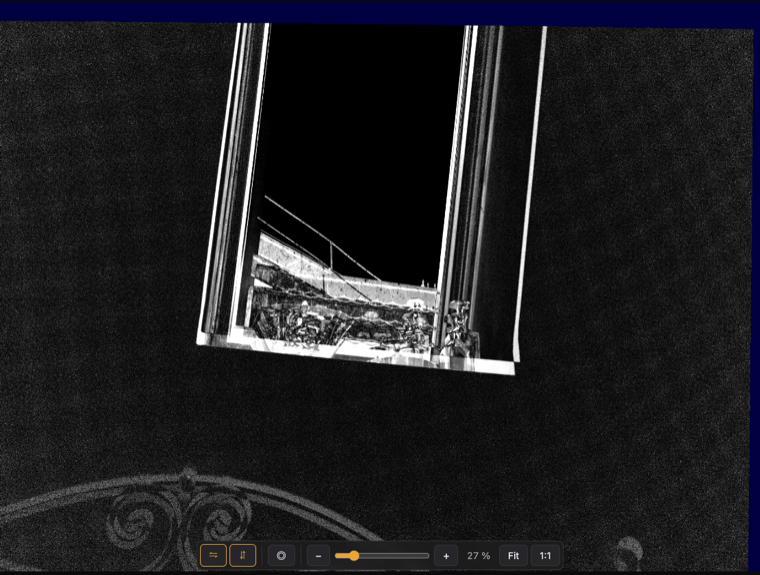

# M3 – Hloubka + refocus

## Krok 1: geometrická kalibrace modulů (2026-10-22)

Ověřeno na prvním reálném LRI (režim 28 mm, 35 mm ekv., A1–A5 + B1–B5, firmware 1.0.53531,
bez lightcalu → kalibrace z hlavičky LRI).

### Co LRI obsahuje

`LightHeader.module_calibration[].geometry` pro všech 16 modulů:

- `per_focus_calibration[].intrinsics.k_mat`: K v px plného rozlišení (f ≈ 3370 px u A).
  Pro obě kalibrační vzdálenosti (818 a 1500 mm) je K stejná, bere se první.
- `per_focus_calibration[].extrinsics.canonical`: R, t vůči A1 v mm. A moduly mají bázi
  25–45 mm. B4, C5 a C6 (pevné zrcátko, `mirror_type 1`) mají virtuální pózu.
  Moduly s pohyblivým zrcátkem (`mirror_type 2`) mají místo ní `mirror_system`, zatím
  nepodporováno.
- `distortion.polynomial`: střed, normalizace (4160 px), 5 koeficientů.

### Ověřené konvence

Test: SIFT shody A1 ↔ Ax, symetrická vzdálenost od epipolárních čar daných kalibrací
(nezávislé na hloubce scény). Varianty: 4 orientace senzoru × 2 směry extrinsiky ×
5 modelů distorze.

| Konvence | Výsledek |
|---|---|
| Souřadnice | **raw orientace senzoru** (bez `develop.orient`) |
| Extrinsika | **X_cam = R · X_A1 + t** (opačný směr: NCC 0,20 proti 0,68) |
| Distorze | **radiální polynom v r², raw = poly(ideal)**, stejně jako mizukage `DistortionParams` |

Na čistě středových shodách se varianty distorze liší málo. Radiální `fwd` je ale nejlepší
nebo nejlepší ex aequo u všech modulů.

### Přesnost

Tovární kalibrace a malá korekce rotace z SIFT shod (prior σ = 0,1°, aby korekce
nepohltila posun podél epipolár, bez prioru by „ujela“ až o 2,4°):

| Modul | Shody (inliery) | Epipolární chyba tovární → doladěná | Korekce |
|---|---|---|---|
| A2 (mono) | 109/137 | 2,72 → **0,47 px** | 0,072° |
| A3 | 138/170 | 3,15 → **0,41 px** | 0,058° |
| A4 | 115/156 | 0,34 → **0,30 px** | 0,029° |
| A5 | 128/155 | 2,75 → **0,33 px** | 0,045° |
| B4 (70 mm, pevné zrcátko) | 94/149 | 0,96 → **0,54 px** | 0,051° |

Validace na odložené polovině shod dává stejné hodnoty (0,4–0,8 px), korekce se tedy
nepřeučuje.

### Náhled v editoru

Panel **Module alignment**: modul se na GPU (`tone.frag`, `sampleModule`) převede na
referenční kameru přes rovinu ve zvolené vzdálenosti. Slider je lineární v dioptriích,
protože paralaxa je úměrná 1/Z. Režimy: Blend, Difference (rozdíl jasu), Blink.
Homografie v `align.ts` se shoduje s `geometry.plane_homography` na 1e-13.

| Rovina 2,15 m (rám okna sedí) | Rovina 0,60 m (rám zdvojený) |
|---|---|
|  |  |

### Další nálezy

- `RawImage.to_debayered_numpy(half_res=True)` vrací u **mono** modulů (A2) plné
  rozlišení. Náhledy modulů se proto vždy zmenšují na `PREVIEW_MAX_SIDE`.
- Snímek vychází s `develop.orient` vzhůru nohama, přestože IMU hlásí `NORMAL`.
  Hypotéza: focení vzhůru na střešní okno, kdy IMU nepozná „nahoru“. Kalibrace
  orientaci nepotvrzuje ani nevyvrací, protože pracuje v raw souřadnicích. Ověřit na
  dalších snímcích.

### Další krok

Krok 2: plane-sweep stereo z A modulů → hloubková mapa (prototyp na CPU, potom GPU).
